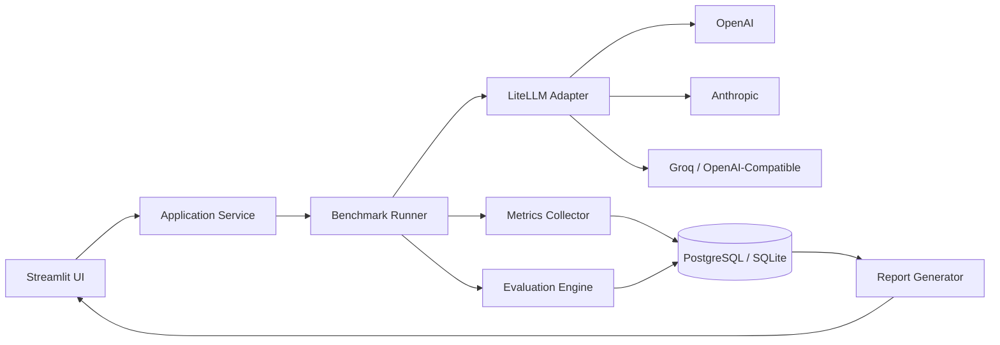

# PromptBench Studio

> Çoklu LLM modellerini aynı senaryo altında hız, maliyet, token tüketimi ve çıktı kalitesi bakımından karşılaştıran açık kaynak test ve benchmark platformu.

## 1. Proje Kimliği

- **Önerilen repo adı:** `promptbench-studio`
- **Proje türü:** AI Engineering / LLM Evaluation / Developer Tool
- **Lisans önerisi:** Apache-2.0
- **Ana kullanıcı grubu:** AI geliştiricileri, prompt mühendisleri, küçük ürün ekipleri ve farklı model sağlayıcılarını karşılaştırmak isteyen araştırmacılar
- **Temel çıktı:** Aynı prompt için çoklu model yanıtları, performans metrikleri, otomatik değerlendirme puanları ve karşılaştırmalı rapor

## 2. Projenin Amacı

PromptBench Studio; aynı sistem promptunu, kullanıcı mesajını ve model parametrelerini birden fazla LLM sağlayıcısına paralel olarak gönderir. Gelen sonuçları yalnızca metin olarak yan yana göstermekle kalmaz; aşağıdaki metrikleri de toplar:

- Toplam yanıt süresi
- İlk token süresi
- Girdi ve çıktı token sayısı
- Tahmini API maliyeti
- Yanıt uzunluğu
- Hata ve yeniden deneme sayısı
- Yapısal çıktı geçerliliği
- Kullanıcı puanı
- LLM-as-a-Judge puanı
- Tekrarlanabilirlik ve tutarlılık

Projenin ana hedefi “hangi model daha iyi?” sorusuna genel bir cevap vermek değil, **belirli bir görev ve ölçüt seti için hangi modelin daha uygun olduğunu ölçülebilir biçimde göstermek** olmalıdır.

## 3. Problem Tanımı

Farklı LLM sağlayıcıları arasında karşılaştırma yaparken genellikle şu sorunlar yaşanır:

1. Her sağlayıcının API biçimi farklıdır.
2. Model fiyatları ve token hesapları tek yerde tutulmaz.
3. Yanıt kalitesi çoğunlukla öznel değerlendirilir.
4. Testler kayıt altına alınmadığı için aynı deney tekrar üretilemez.
5. Hız, kalite ve maliyet arasında karar vermek zorlaşır.
6. Prompt veya model değişikliklerinin etkisi geçmiş koşularla karşılaştırılamaz.

PromptBench Studio bu süreci standartlaştırır ve deneyleri kayıt altına alır.

## 4. Kapsam

### MVP kapsamında

- OpenAI uyumlu API desteği
- Anthropic desteği
- Groq veya başka bir düşük gecikmeli sağlayıcı desteği
- LiteLLM üzerinden ortak model arabirimi
- Sistem promptu ve kullanıcı promptu girişi
- Birden fazla model seçimi
- Paralel istek yürütme
- Token, gecikme ve maliyet ölçümü
- Yanıtları yan yana karşılaştırma
- Basit LLM-as-a-Judge değerlendirmesi
- Test geçmişi
- JSON ve CSV dışa aktarma
- Streamlit tabanlı kullanıcı paneli

### MVP dışında

- Kurumsal kullanıcı yönetimi
- Çok kiracılı SaaS mimarisi
- Gerçek zamanlı ekip çalışması
- Ödeme sistemi
- Büyük ölçekli dağıtık benchmark altyapısı
- Fine-tuning yönetimi
- Sağlayıcı faturalarının otomatik tahsilat eşleştirmesi

## 5. Temel Kullanım Senaryoları

### Senaryo A — Model seçimi

Bir geliştirici, müşteri destek yanıtları için üç farklı modeli aynı veri setinde test eder. Sistem hız, maliyet, doğruluk ve ton uygunluğu bakımından sıralama üretir.

### Senaryo B — Prompt optimizasyonu

Aynı model üzerinde Prompt A ve Prompt B test edilir. Kalite skorları ve maliyet farkı karşılaştırılır.

### Senaryo C — Structured output testi

Modellerden belirli bir JSON şemasına uygun çıktı istenir. Sistem geçersiz JSON oranını ve şema uyumluluğunu ölçer.

### Senaryo D — Regresyon testi

Daha önce başarılı olan bir prompt, yeni model sürümü veya yeni parametrelerle tekrar çalıştırılır. Sonuçlar geçmiş koşuyla kıyaslanır.

## 6. Fonksiyonel Gereksinimler

### 6.1 Test oluşturma

Kullanıcı aşağıdaki alanları girebilmelidir:

- Test adı
- Açıklama
- Sistem promptu
- Kullanıcı promptu
- Seçilen modeller
- Temperature
- Max output token
- Timeout
- Tekrar sayısı
- Değerlendirme kriterleri
- Opsiyonel beklenen yanıt veya referans cevap
- Opsiyonel JSON Schema

### 6.2 Model çağrıları

- İstekler mümkün olduğunca paralel çalıştırılmalıdır.
- Her çağrı için benzersiz bir run ID üretilmelidir.
- Timeout ve rate-limit hataları kontrollü biçimde ele alınmalıdır.
- Yeniden deneme politikası exponential backoff kullanmalıdır.
- Sağlayıcıdan gelen ham kullanım bilgisi saklanmalıdır.
- API anahtarları hiçbir zaman loglara yazılmamalıdır.

### 6.3 Metrik toplama

Her model sonucu için:

- `latency_ms`
- `time_to_first_token_ms`
- `input_tokens`
- `output_tokens`
- `total_tokens`
- `estimated_cost_usd`
- `characters`
- `words`
- `finish_reason`
- `retry_count`
- `status`
- `provider_error`
- `schema_valid`

alanları kaydedilmelidir.

### 6.4 Kalite değerlendirmesi

İlk sürümde aşağıdaki değerlendirme türleri desteklenebilir:

- Manuel kullanıcı puanı
- Kelime veya ifade kontrolü
- Regex tabanlı kontrol
- JSON Schema geçerlilik kontrolü
- Referans cevaba semantik benzerlik
- LLM-as-a-Judge
- Cevap uzunluğu sınırı
- Yasaklı ifade kontrolü

### 6.5 Raporlama

- Model bazlı karşılaştırma tablosu
- Maliyet-kalite grafiği
- Gecikme-kalite grafiği
- Test koşuları geçmişi
- En iyi model önerisi
- CSV ve JSON export
- Markdown benchmark raporu

## 7. Önerilen Sistem Mimarisi



## 8. Teknoloji Yığını

### Backend

- Python 3.12+
- LiteLLM
- Pydantic
- SQLAlchemy
- asyncio
- Tenacity
- tiktoken veya sağlayıcıya özel tokenizer
- httpx

### Arayüz

- İlk sürüm: Streamlit
- İleri sürüm: Next.js + FastAPI

### Veri tabanı

- Yerel MVP: SQLite
- Üretim: PostgreSQL

### Grafik ve raporlama

- Plotly
- Pandas
- Jinja2
- Markdown export

### Test

- pytest
- pytest-asyncio
- respx veya responses
- Ruff
- mypy

## 9. Veri Modeli

### `providers`

| Alan | Tür | Açıklama |
|---|---|---|
| id | UUID | Sağlayıcı kimliği |
| name | string | OpenAI, Anthropic vb. |
| base_url | string | Opsiyonel özel endpoint |
| enabled | boolean | Aktiflik durumu |

### `models`

| Alan | Tür | Açıklama |
|---|---|---|
| id | UUID | Model kaydı |
| provider_id | UUID | Sağlayıcı ilişkisi |
| model_key | string | API model adı |
| display_name | string | Arayüz adı |
| input_price | decimal | Milyon token başına maliyet |
| output_price | decimal | Milyon token başına maliyet |
| context_window | integer | Bağlam kapasitesi |
| active | boolean | Kullanılabilirlik |

### `benchmark_tests`

| Alan | Tür |
|---|---|
| id | UUID |
| name | string |
| system_prompt | text |
| user_prompt | text |
| parameters_json | JSON |
| evaluation_config | JSON |
| created_at | datetime |

### `benchmark_runs`

| Alan | Tür |
|---|---|
| id | UUID |
| test_id | UUID |
| model_id | UUID |
| output_text | text |
| raw_response | JSON |
| input_tokens | integer |
| output_tokens | integer |
| cost_usd | decimal |
| latency_ms | integer |
| status | string |
| created_at | datetime |

### `evaluations`

| Alan | Tür |
|---|---|
| id | UUID |
| run_id | UUID |
| evaluator_type | string |
| criterion | string |
| score | float |
| explanation | text |

## 10. Önerilen API Uçları

```text
POST   /api/tests
GET    /api/tests
GET    /api/tests/{test_id}
POST   /api/tests/{test_id}/run
GET    /api/runs/{run_id}
GET    /api/tests/{test_id}/results
POST   /api/runs/{run_id}/evaluate
GET    /api/models
POST   /api/models/sync
GET    /api/reports/{test_id}
```

## 11. Arayüz Sayfaları

1. **Dashboard**
   - Son testler
   - Toplam maliyet
   - En sık kullanılan modeller
   - Başarı ve hata oranı

2. **New Benchmark**
   - Prompt alanları
   - Model seçimi
   - Parametreler
   - Değerlendirme kriterleri

3. **Live Results**
   - Model kartları
   - Akış sırasında durum
   - Yanıtlar
   - Token ve süre bilgileri

4. **Comparison**
   - Karşılaştırma tablosu
   - Grafikler
   - Kazanan model
   - Judge gerekçesi

5. **History**
   - Test koşuları
   - Filtreler
   - Eski ve yeni sonuç kıyaslama

6. **Settings**
   - Sağlayıcılar
   - API anahtarları
   - Fiyat verileri
   - Varsayılan değerlendirme modeli

## 12. Repo Yapısı

```text
promptbench-studio/
├── app/
│   ├── main.py
│   ├── config.py
│   ├── domain/
│   │   ├── models.py
│   │   └── schemas.py
│   ├── providers/
│   │   ├── base.py
│   │   └── litellm_provider.py
│   ├── benchmark/
│   │   ├── runner.py
│   │   ├── metrics.py
│   │   └── pricing.py
│   ├── evaluation/
│   │   ├── judge.py
│   │   ├── schema_validator.py
│   │   └── rules.py
│   ├── repositories/
│   └── services/
├── ui/
│   ├── Home.py
│   └── pages/
├── tests/
│   ├── unit/
│   ├── integration/
│   └── fixtures/
├── data/
│   └── model_pricing.example.json
├── docs/
│   ├── architecture.md
│   └── evaluation.md
├── .env.example
├── docker-compose.yml
├── pyproject.toml
├── README.md
└── LICENSE
```

## 13. Güvenlik Gereksinimleri

- API anahtarları `.env` veya secret manager üzerinden yönetilmelidir.
- Prompt ve model çıktılarında kişisel veri bulunabileceği açıkça belirtilmelidir.
- Loglarda prompt içeriğini saklama seçeneği kapatılabilmelidir.
- Kullanıcı girdileri UI tarafında güvenli biçimde render edilmelidir.
- CSV/Markdown export işlemleri injection risklerine karşı temizlenmelidir.
- Judge modeline gönderilen veriler, değerlendirme talimatlarından ayrıştırılmalıdır.
- SSRF oluşturabilecek kullanıcı tanımlı endpoint girişleri kısıtlanmalıdır.

## 14. Test Stratejisi

### Birim testleri

- Fiyat hesaplama
- Token verisi normalizasyonu
- JSON Schema doğrulama
- Model yanıtı dönüştürme
- Judge puan parser'ı
- Hata sınıflandırma

### Entegrasyon testleri

- Mock sağlayıcılarla uçtan uca benchmark
- Timeout ve retry senaryoları
- Veri tabanı kayıtları
- Export işlemleri

### Kabul testleri

- En az üç model aynı anda test edilebilmeli.
- Bir model hata verdiğinde diğer sonuçlar kaybolmamalı.
- Maliyet hesaplaması model fiyat tablosuyla uyumlu olmalı.
- Test sonucu JSON ve CSV olarak dışa aktarılabilmeli.
- Judge değerlendirmesi gerekçe ve skor üretmeli.

## 15. Aşamalandırılmış Yol Haritası

### Faz 1 — Temel altyapı

- Proje iskeleti
- Ortam değişkenleri
- LiteLLM bağlantısı
- Tek model çağrısı
- Standart yanıt modeli

### Faz 2 — Benchmark motoru

- Paralel model çalıştırma
- Token ve gecikme ölçümü
- Maliyet hesaplama
- Retry ve hata yönetimi

### Faz 3 — UI ve kayıt

- Streamlit paneli
- SQLite
- Test geçmişi
- Karşılaştırma görünümü

### Faz 4 — Değerlendirme

- LLM-as-a-Judge
- Rule-based kontroller
- JSON Schema testi
- Kullanıcı puanları

### Faz 5 — Ürün kalitesi

- Docker
- CI
- Test kapsamı
- Demo veri seti
- Dokümantasyon
- Canlı demo

## 16. GitHub Sunum Kontrol Listesi

- Açıklayıcı README
- Mimari diyagram
- GIF veya kısa demo videosu
- Ekran görüntüleri
- `.env.example`
- Docker ile tek komut kurulum
- Örnek benchmark veri seti
- Demo çıktısı
- Test badge'i
- Lisans
- Katkı rehberi
- Issue şablonları

## 17. Başarı Kriterleri

MVP tamamlanmış sayılabilmesi için:

- En az üç farklı sağlayıcı/model desteklenmeli.
- Aynı prompt paralel çalıştırılmalı.
- Maliyet, token ve süre doğru kaydedilmeli.
- En az iki değerlendirme yöntemi bulunmalı.
- Sonuçlar geçmişte saklanmalı.
- Arayüz üzerinden test başlatılabilmeli.
- Docker ile yerel kurulum yapılabilmeli.
- GitHub Actions testleri başarıyla çalışmalı.

## 18. Genişletme Fikirleri

- Dataset tabanlı toplu benchmark
- Prompt regresyon testleri
- CI içinde kalite eşiği
- OpenTelemetry tracing
- Model fallback simülasyonu
- Yerel Ollama modelleri
- İnsan değerlendirme kuyruğu
- ELO tabanlı model sıralaması
- Kurumsal ekip alanları
- Kendi özel değerlendirme fonksiyonunu ekleme
